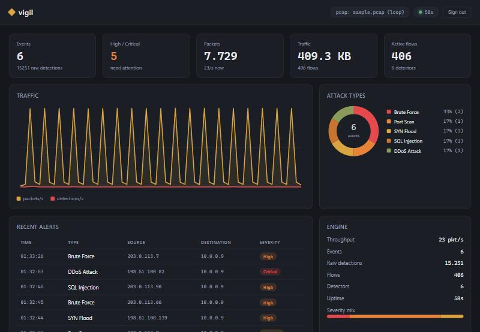

# vigil

A network intrusion detection engine. It reads packets, either live off an
interface or replayed from a pcap, normalizes them into one record type, and
runs them through a set of independent detectors: signature rules for known-bad
payloads and behavioral detectors for scans, floods, brute force and DNS
tunneling. Raw detections are correlated into a small number of real events
instead of a wall of duplicates.

The detection core depends only on the Python standard library, so it is easy
to read, test and embed. Scapy is used for capture, click and rich for the CLI.
An optional web layer serves a live dashboard over an authenticated HTTP API.

## Install

```
git clone https://github.com/ReazGan/vigil
cd vigil
pip install -e .
```

Python 3.10 or newer. Live capture needs root/administrator privileges, and
Npcap on Windows. Reading pcap files needs neither.

## Usage

Replay a capture file:

```
vigil replay capture.pcap
```

Sniff a live interface (filter with BPF syntax):

```
vigil live --iface eth0 --bpf "tcp or udp port 53"
```

List the detectors and signature rules:

```
vigil rules
```

Serve the live dashboard (needs the `api` extra: `pip install -e ".[api]"`):

```
vigil serve --pcap capture.pcap
```

Add `--json` to `replay` or `live` to emit one JSON object per event for
piping into another tool.

## Example

Running against the sample capture (`python tools/make_sample_pcap.py`):

```
16:46:50  Medium    Port Scan      203.0.113.7 probed 20 ports on 10.0.0.9 within 5s
16:46:51  High      SYN Flood      SYN flood on 10.0.0.9: 200 half-open SYNs in 2s (~100/s)
16:46:54  High      Brute Force    203.0.113.66 opened 15 connections to 10.0.0.9:22 in 30s
16:46:57  High      SQL Injection  signature 'sqli-union' matched 203.0.113.90 -> 10.0.0.9:80

Packets: 406   Events: 4   (from 221 raw detections)
```

The 221 raw detections from the ongoing scan and flood collapse into 4 events,
one per attack.

## Dashboard

`vigil serve` runs a live dashboard backed by the same engine, behind a token
login. It shows traffic over time, the attack-type breakdown, recent alerts and
engine throughput, polling the API a couple of times a second. The charts are
drawn inline with no front-end framework or CDN, so it works offline.



The HTTP API is small: `POST /api/login` returns a JWT, and `GET /api/stats`,
`/api/events` and `/api/timeseries` serve the data behind a bearer token. The
login password is read from `VIGIL_PASSWORD`, or generated and printed once at
startup if that is unset.

## How it works

```
capture  ->  normalize  ->  detectors  ->  correlator  ->  output
(pcap or    (one Packet    (6 independent  (dedup +        (CLI / JSON)
 live)       record type)   detectors)      stats)
```

Every layer is decoupled: detectors never learn whether a packet came off the
wire or out of a file, and the pipeline never learns where alerts go. That is
why a live capture, a pcap replay and a unit test all exercise the exact same
detection code.

| Detector    | Type        | Catches                                             |
|-------------|-------------|-----------------------------------------------------|
| portscan    | behavioral  | one source probing many ports on a host             |
| synflood    | behavioral  | a burst of half-open SYNs against a host            |
| ddos        | behavioral  | many distinct sources flooding one host             |
| bruteforce  | behavioral  | repeated connections to SSH/RDP/FTP/database ports  |
| dnstunnel   | behavioral  | long, high-entropy DNS query names                  |
| signature   | signature   | SQLi, XSS, path traversal, command injection        |

Thresholds live in one place (`vigil/config.py`) so they can be tuned against a
traffic corpus without touching detector code.

## Testing

```
pip install -e ".[dev]"
pytest
```

The behavioral and signature detectors are tested with hand-built packets, so
the suite runs without scapy in a fraction of a second. One integration test
replays the sample pcap through the full pipeline.

## Benchmark

```
python bench/benchmark.py 200000
```

On a single core (CPython 3.14) the engine sustains around 116,000 packets per
second through all six detectors and the correlator.

## Docker

```
docker compose up --build
```

The dashboard comes up on port 8089 replaying a bundled sample capture. Set
`VIGIL_PASSWORD` in the environment, or read the generated one from the logs.
Live capture in a container needs host networking and `NET_RAW`; see the
commented service in `docker-compose.yml`.

## Run as a service

To run vigil as a hardened systemd service on a Linux server (live capture,
dashboard bound to localhost, dedicated user with only `CAP_NET_RAW`):

```
curl -fsSL -o install-service.sh https://raw.githubusercontent.com/ReazGan/vigil/main/deploy/install-service.sh
sudo bash install-service.sh
```

The dashboard is never exposed; reach it over an SSH tunnel
(`ssh -L 8089:127.0.0.1:8089 you@server`). See
[deploy/install-service.sh](deploy/install-service.sh).

## Design

Architecture, trade-offs, the scaling path, the threat model and known
limitations are written up in [docs/DESIGN.md](docs/DESIGN.md).

## License

MIT
